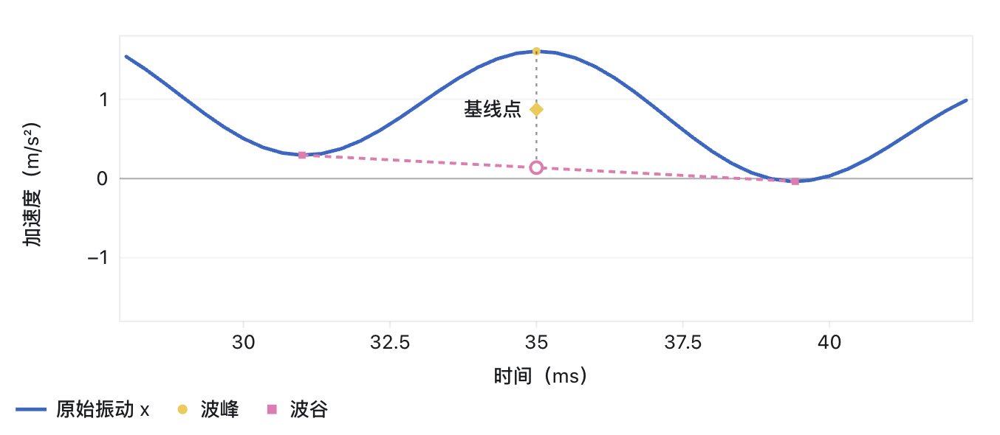
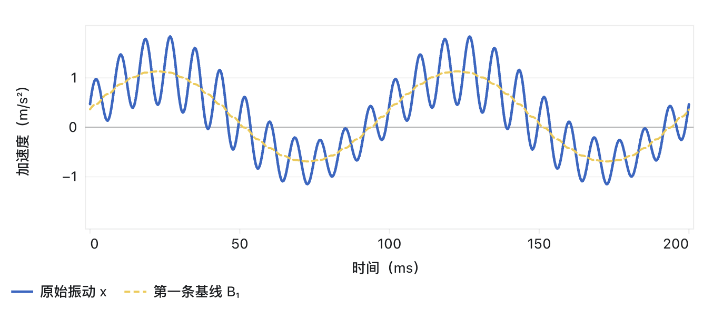
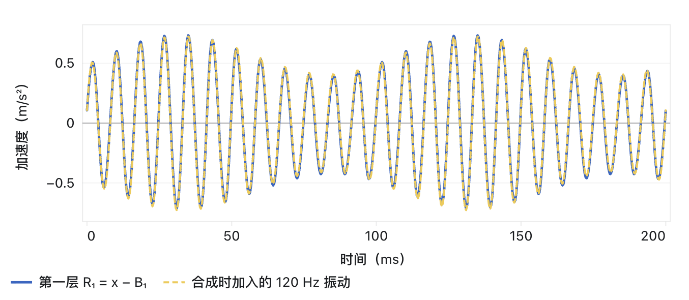
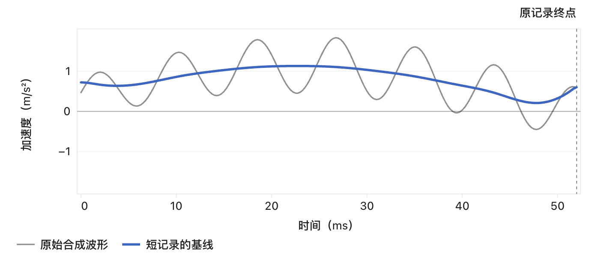
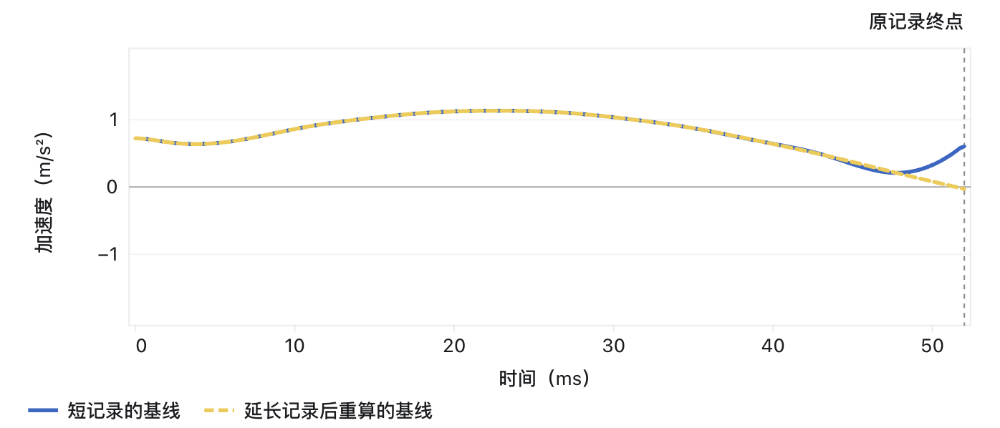

## 弌 固有时间尺度分解 ITD

##### 原理

对相邻的两个波谷和夹在中间的一个波峰，计算出基准点，随后拟合出基线。

总的来说，ITD 首先通过波谷和波峰的相对位置绘出基线\(B_1\)，随后原始波形减去该基线得到旋转分量\(R_1\)，完成了一次筛分。

这里的\(B_1\)没有约束条件，这点区别于 EMD，完成\(B_1\)的计算后直接认为完成了这一层筛选。

仍然，由于LCD仍采用三次样条拟合瞬时均值，因此也受到端点效应和模态混叠的影响。

