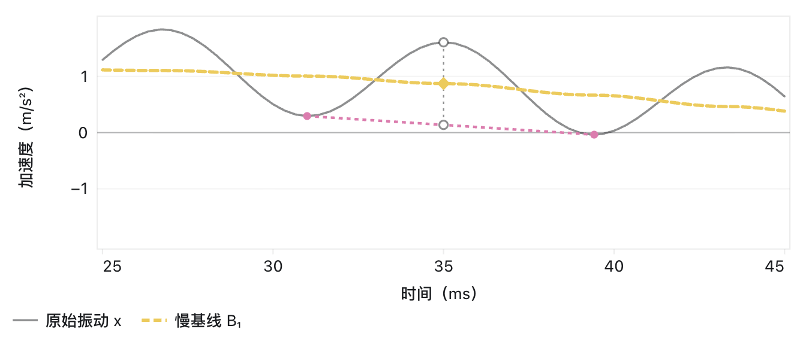
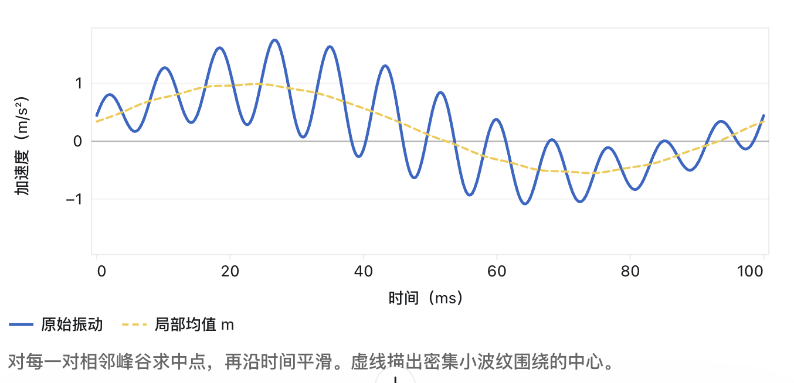
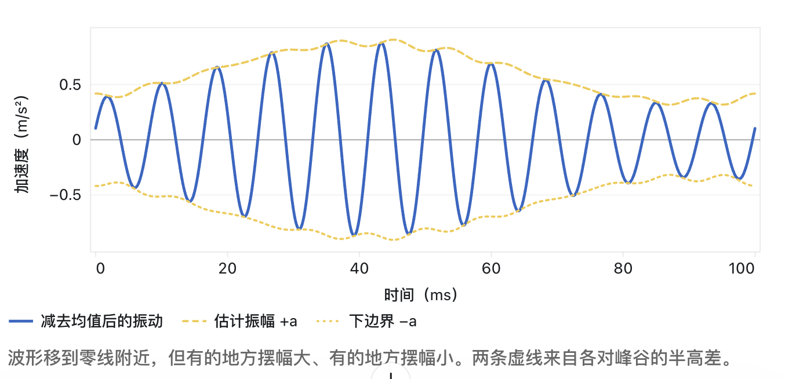
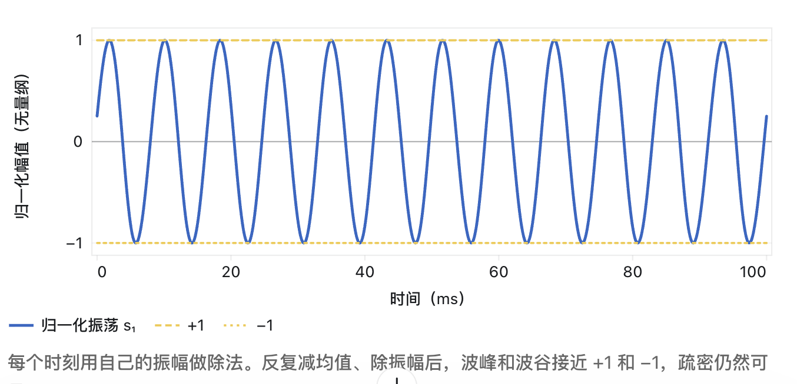

## 弌 局部均值分解 LMD

核心公式：

\(PF(t) = A(t) * s(t)\)

\(A(t)\)描述振动强度随时间变化，\(s(t)\)描述振动的频次。

此处的\(PF(t)\)和 EMD 方法中的 \(IMF\) 是同类型的角色，但同一段信号使用两种方法得到的二者并不一致。

相比 EMD 的优势：可减少计算时间、改善拟合并抑制端点效应（这点优势来自于其基线的计算准则），且无须复杂筛分，计算量较低。