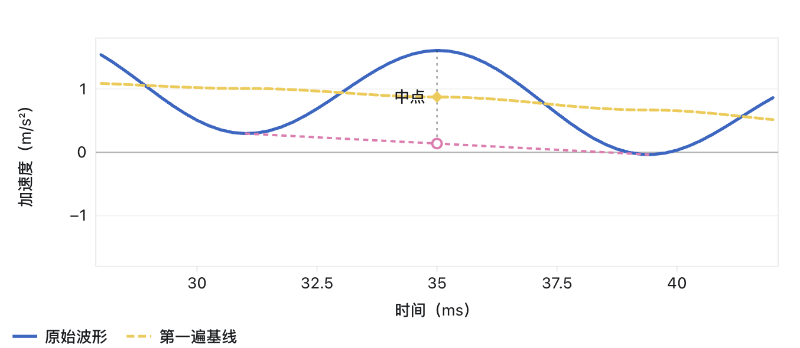
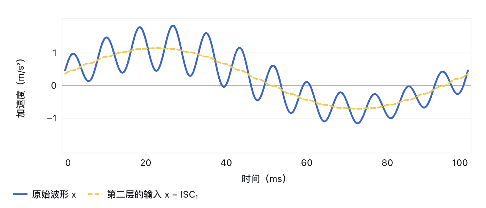

## 局部特征尺度分解 LCD

LCD 的基线绘制规则和 ITD 一致，但是筛掉基线后还需要检查剩余的快波形是否满足：

- 峰谷异号
- 其新基线是否接近零线

如果不满足，则需要再筛去新基线，直到满足判断条件。

假设某一轮需要筛两次，有：
\[
\begin{aligned}
h_1 &= x-b_1\\
h_2 &= h_1-b_2=x-b_1-b_2
\end{aligned}
\]

\[
\underbrace{x-\mathrm{ISC}_1}_{\text{第二层的输入}}
=\underbrace{b_1+b_2}_{\text{第一层两遍减掉的基线之和}}
\]