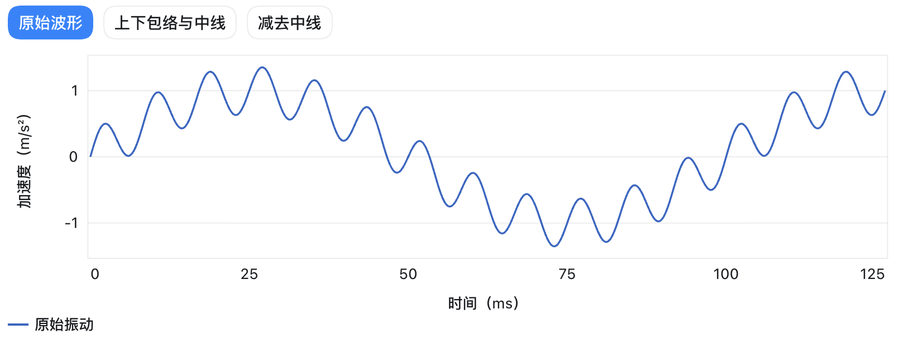
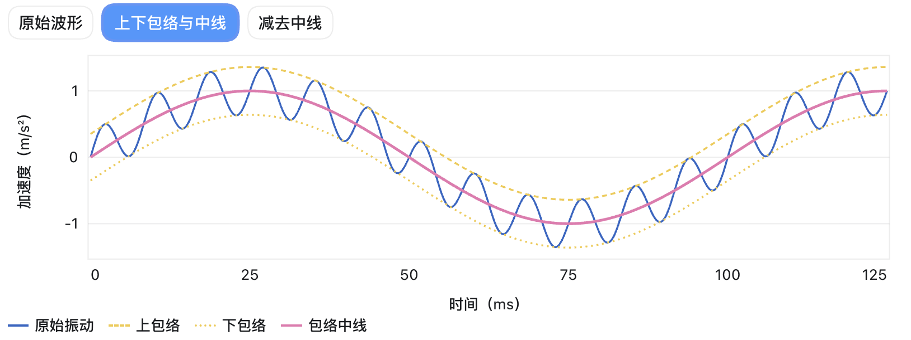
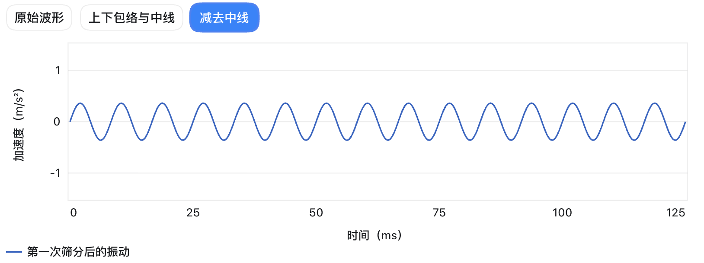
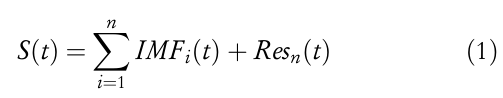
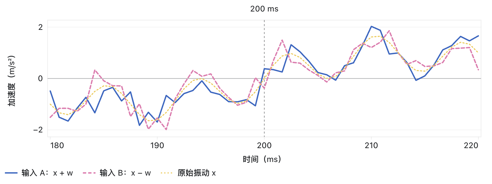
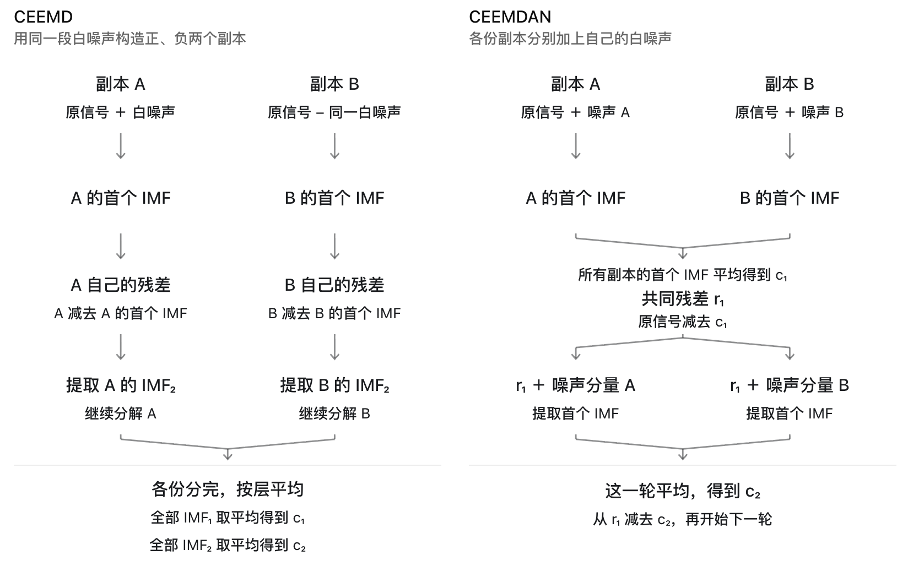

## 弌 经验模态分解 EMD

##### 原理

总的来说，EMD 首先通过上包络和下包络的平均得到一条中线，随后原始波形减去该中线，完成了一次筛分。

这一次筛分后如果**大致**满足：
1. 极值点和零点数相差 ≤ 1
2. 中线为 y = 0 

那么就可以认为剩余波形为 $IMF_1$。

随后，我们将原始波形减去 $IMF_1$，继续拆分 $IMF_2$。

最终我们讲一条复杂、不规律的波形分成多个规律的波形组合。

##### 终止条件：

如果余量已经是常数、单调趋势，或极值点太少，无法再构造上下包络，整个分解就结束。余量认为是 $Res_n(t)$

##### 缺陷

1. 模态混叠

2. 端点效应

3. 停止准则不好确定

了解阶段，暂时不做细究。

## 弍 集合经验模态分解 EEMD

EEMD 是为了缓解模态混淆而对 EMD 做的改进方法。

简单的说：
1. 把原始波形复制多份\(x\)。
2. 分别加入白噪声后进行 EMD 处理。得到\(x+w\)和\(c_1\)
3. 对每一份 copy，减去 \(c_1\)后(\(x+w-c_1\))再进行 EMD。
4. 最终各自的结果取平均得到最终的各层 $IMF_n$

从直观的角度，他首先引入白噪声来削减非故障时段的波形被纳入筛除段的比例，随后通过平均来消除其本身带来的影响。

*“EEMD 每次加入不同的白噪声，让故障冲击之间的时段也有快慢不同的起伏可供筛分，从而减少背景慢振动混入快振动分量的情况。随后，把多次分解得到的同一层 IMF 逐点平均，使随机噪声的影响减弱，而每次都在相同时刻出现的故障冲击更容易保留下来。”*

##### 缺陷

1. 由于每份 copy 的加噪处理不一致，其经过 EMD 得到的 IMF 可能不一致，导致平均难以求得。

2. 加噪程度和规模的设置依赖经验，难以确定。

3. 噪声难以完全抵消。

## 弎 互补集合经验模态分解 CEEMD

CEEMD 通过采取互补成对的噪声，来抵消重构后的多余噪声，并减少所需分解次数、降低计算成本。旨在解决噪声难以完全抵消的问题。

## 亖 带自适应噪声的完备集合经验模态分解 CEEMDAN

CEEMDAN 相比 CEEMD，针对 $IMF$ 的求取思路不同：
- CEEMD 在每一份 copy **完整算完**后再将每一层的 $IMF$ 分别平均。
- CEEMDAN 在每一份 copy 的每一层都**先求取平均 $IMF$ 再算下一层**。

- 注意这里的 CEEMDAN 在每一层都有加噪操作。