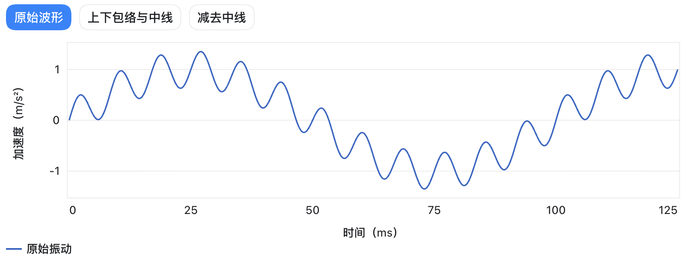
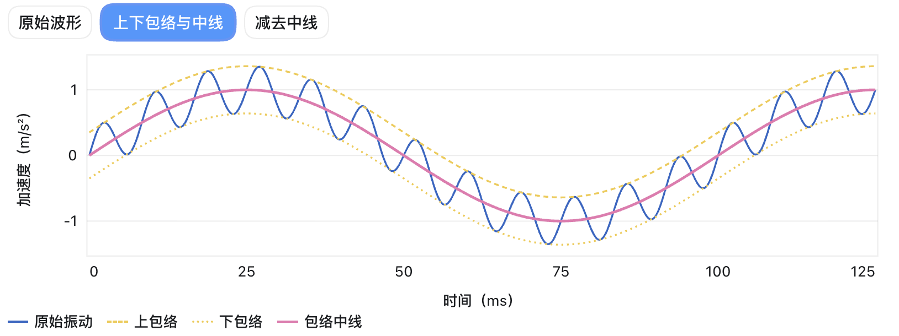
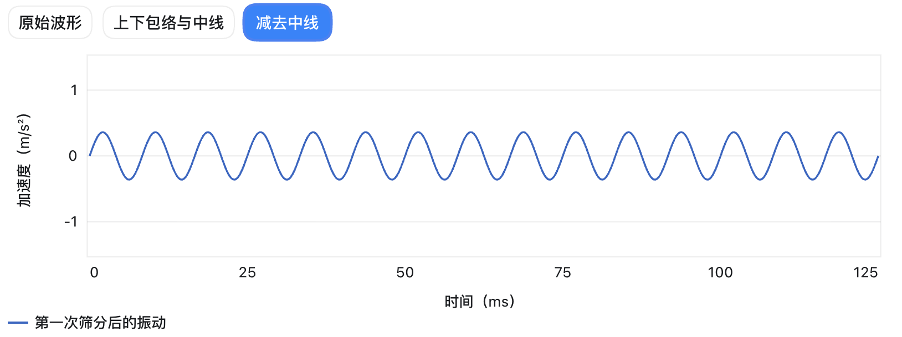
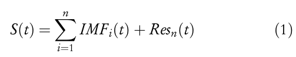

## 经验模态分解 EMD

##### 原理

总的来说，EMD 首先通过上包络和下包络的平均得到一条中线，随后原始波形减去该中线，完成了一次筛分。

这一次筛分后如果**大致**满足：
1. 极值点和零点数相差 ≤ 1
2. 中线为 y = 0 

那么就可以认为剩余波形为 $IMF_1$。

随后，我们将原始波形减去 $IMF_1$，继续拆分 $IMF_2$。

最终我们讲一条复杂、不规律的波形分成多个规律的波形组合。

##### 终止条件：

如果余量已经是常数、单调趋势，或极值点太少，无法再构造上下包络，整个分解就结束。余量认为是 $Res_n(t)$

##### 缺陷

1. 模态混叠

2. 端点效应

3. 停止准则不好确定

了解阶段，暂时不做细究。